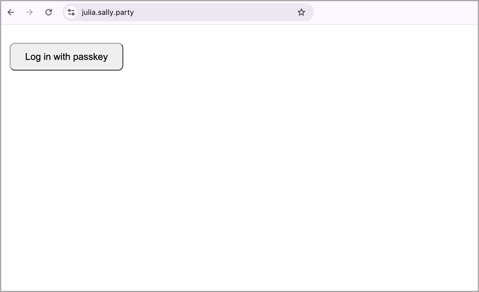
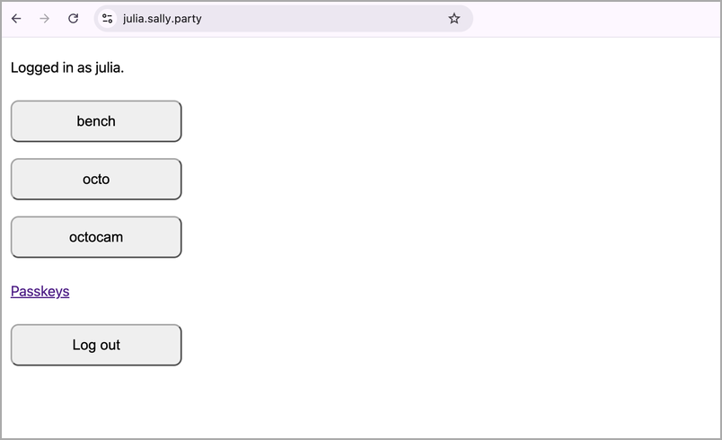
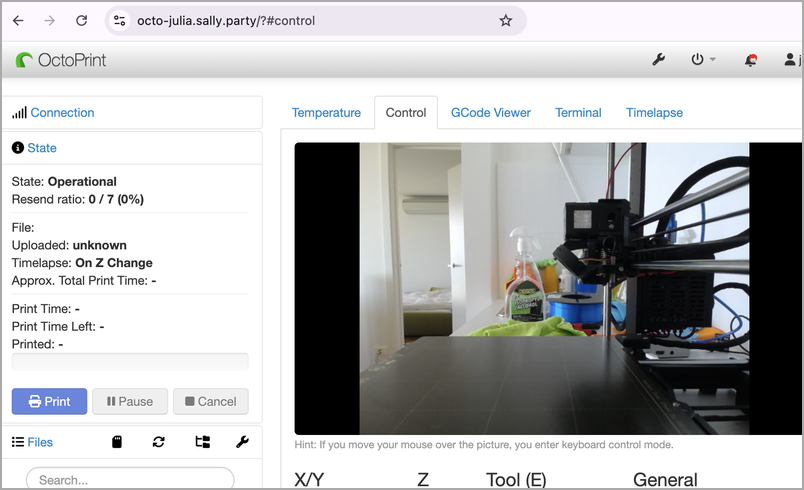
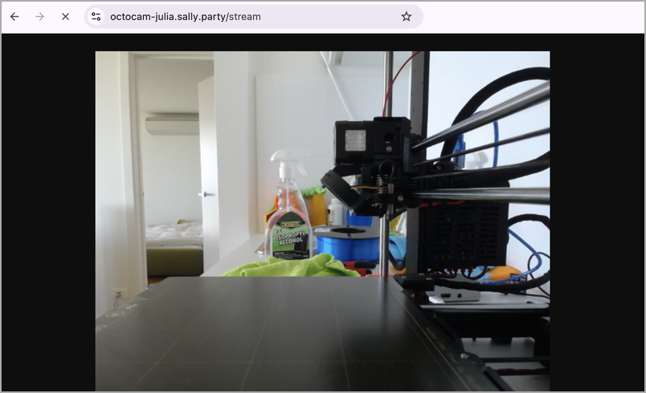
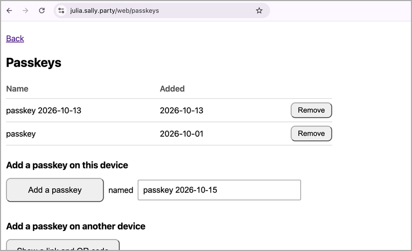
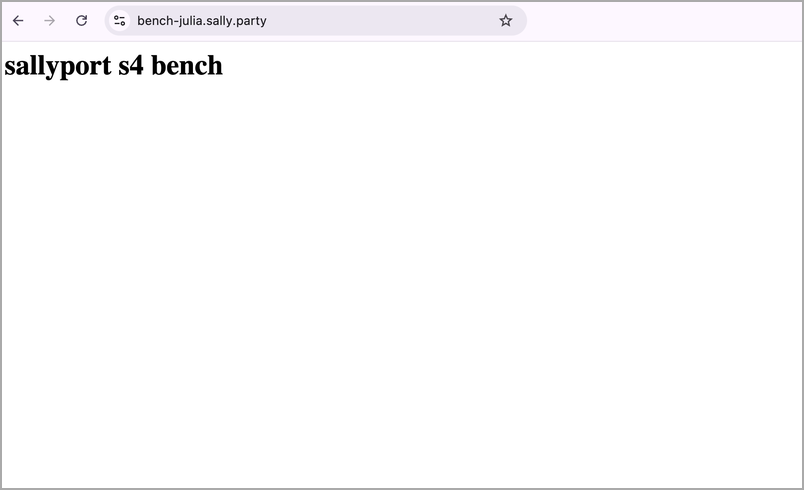

#  Sallyport

Sallyport gives access to web apps on a home network from anywhere, with
Teleport login and passkeys, through a Cloudflare Worker. The server at
home only dials out, so no port is open to the internet, and there is no
need for a VPN.

Sallyport is a personal proof of concept and is not battle-tested. The
author works at Teleport, but Sallyport is not a Teleport project, and
Teleport does not support it. For full Teleport features and support, use
[Teleport Cloud][cloud].

## Why

Teleport gives access to apps with roles, passkeys and an audit log, but
a full Teleport cluster is a lot to run for a home network. Its proxy
needs a public address, an open port and a server that is always on.
Sallyport is a variant that puts only a small part on the internet, a hub
on Cloudflare's free Workers plan. Teleport's auth service, with the
users, roles, sessions and audit log, stays on the home network.

Many devices at home have a web UI that was never meant to face the
internet:

- a 3D printer running OctoPrint, with its webcam
- a solar inverter or home battery dashboard
- Home Assistant or another home automation UI
- the admin page of a NAS

The usual ways to reach them from outside each have a cost. A forwarded
port puts the device's own login, or no login, on the internet. A VPN
gives each client the whole home network and needs a client on every
phone and laptop. Cloudflare Tunnel with Cloudflare Access gives per-app
access with no open ports, but the users, rules and audit log then live
in Cloudflare. Sallyport keeps them in Teleport at home.

Sallyport gives access to one app at a time, in a normal browser:

- **Per app, optionally for a set time.** Each app has its own address.
  Teleport roles decide which users may open which apps, and for how long.
  See [Temporary access](#temporary-access).
- **Passkeys.** Users log in with a passkey. A user can have several,
  for example one on a phone and one on a laptop.
- **Audit.** Teleport records each login and app session. The records
  show a Cloudflare address in place of the user's IP.

## Screenshots

| | |
|:---:|:---:|
| Log in with a passkey.<br> | Pick an app on the dashboard.<br> |
| Control the printer in OctoPrint.<br> | Watch the printer's webcam.<br> |
| Add a passkey on another device.<br> | A static test app.<br> |

## How it works

Sallyport has two parts.

- **The hub** is a stand-in for the Teleport proxy service. It is written
  in Go, compiled to WebAssembly, and runs as a Cloudflare Worker with one
  Durable Object. A Durable Object is a single instance of the code, with
  a fixed name, that every request reaches. The hub serves a minimal
  login page, the app dashboard and the passkey pages, and it forwards
  app requests and WebSockets. It does not cover SSH, databases,
  Kubernetes or `tsh` at this stage.
- **The home side** is one process of a Teleport fork that runs the auth
  service and the app service. The fork is on the branch
  [`sallyport/lazy`][fork] of `juliaogris/teleport`.

On each app request, the hub asks auth whether the user's app session is
still valid. It then sends the request through the app service with the
user's certificate, so Teleport's roles apply as with a stock proxy.

### The Teleport fork

In stock Teleport, the proxy dials the auth service, so auth must be
reachable from the proxy. The fork turns this around with an on-demand
callout:

1. Auth keeps one control WebSocket open to the hub. The hub sends a
   challenge, and auth signs it with the callout key.
2. When the hub needs to call auth or reach an app, it asks auth on the
   control WebSocket to dial a new stream.
3. Auth opens the stream, and the hub uses it for one connection: a call
   to auth, or an app request through the app service.

Stock Teleport agents keep a reverse tunnel open to the proxy, and send
keepalives and heartbeats on it. On Cloudflare, each of those messages
wakes the Durable Object and counts toward the daily request limit. With
the on-demand streams of the [Teleport fork][fork], an idle hub gets only
the control WebSocket's pings. Cloudflare answers these without running
the hub's code.

The changes are mostly one new package, `lib/authcallout`, about 1,600
lines, with about 200 lines of wiring in existing Teleport code.

The fork also adds a tool, `proxymint`. A Teleport proxy gets its
certificate by joining the cluster, which the hub cannot do from
Cloudflare. `proxymint` joins once on the home server, with a one-time
proxy token, and writes the certificate, key and CA to a directory. The
hub reads them from its Worker secrets, and auth and the app service
accept the hub as a proxy because of that certificate.

## Cost

One hub fits Cloudflare's free Workers plan. The limits and numbers below
are from October 2026.

- **Durable Object time.** The free plan allows 13,000 GB-s a day. One
  Durable Object is billed at 128 MB, so even if it is awake all day it
  uses 10,800 GB-s.
- **Requests.** The free plan allows 100,000 requests a day. A login is
  about 20 requests, an app page about 50 to 100, and a webcam stream is
  one long request. These are estimates.

Several hubs on one free account can run out of Durable Object time, and
the account then stops serving until 00:00 UTC. Anyone who knows the
hostnames can do the same with the request limit, or flood the login page
until auth refuses new streams. See [Rate limiting](#rate-limiting).

## Status

Two hubs have run since October 2026, one on Cloudflare's free plan and
one on a paid plan, each in front of a Raspberry Pi with OctoPrint. The
conformance suite has 277 tests, and the hubs ran a 7-day stability test
with a probe every minute (see [Rust and Go](#rust-and-go)).

## Limitations

- Only web login and app access. SSH, databases, Kubernetes, `tsh` and
  Teleport's access requests are not supported.
- One owner per hub. The login host is `OWNER.DOMAIN`.
- Cloudflare ends the browser's TLS connection, so Cloudflare can read the
  traffic between the browser and the hub.
- The Teleport fork is based on Teleport 18.11.1 and is not upstream.
- Auth trusts the hub by the public TLS certificate of the login host. A
  takeover of the Cloudflare account or the Worker can act as the proxy,
  so the Cloudflare account needs strong login protection.
- Logout clears the browser's cookies, but the session stays valid at auth
  until it expires.
- The hub does not limit requests per client. See
  [Rate limiting](#rate-limiting).

## Setup

### Sample setup

A Raspberry Pi at home runs the Teleport fork, and a Cloudflare account
runs the hub. Any Linux or macOS machine that stays on works in place of
the Pi.

```
+- Internet -------------------------+    +- Home network ---------------------------+
|                                    |    |                                          |
|                  +---------------+ |    |  +---------------+                       |
| +---------+      | Sallyport hub | |    |  | Raspberry Pi  |       +-----------+   |
| | Browser |----->| on Cloudflare |<--------| Teleport fork |------>| OctoPrint |   |
| +---------+      |               | |    |  |               |       +-----------+   |
|                  +---------------+ |    |  +---------------+                       |
|                                    |    |                                          |
+------------------------------------+    +------------------------------------------+
```

- **Browser** - anywhere on the internet or the home network. It connects
  to the hub over HTTPS.
- **Raspberry Pi with the Teleport fork** - runs the Teleport Auth Service
  and the Teleport Application Service. It opens an outbound WebSocket to
  the hub, and reaches the apps on the home network, such as OctoPrint.

Each arrow points from the side that opens the connection.

The setup also uses:

- a domain whose DNS is on Cloudflare, here `example.com`
- a Cloudflare account, on the free or a paid Workers plan
- Go, to build the fork
- Node.js for `npx wrangler`, and Go and `wasm-opt` from Binaryen, to
  build and deploy the hub. This can be any machine, such as a laptop.

The examples use `me.example.com` as the login host and one app,
`printer`, at `printer-me.example.com`. The login host is `OWNER.DOMAIN`,
and each app is at `<app>-OWNER.DOMAIN`. An app in `SUB_APPS` is at
`<app>.OWNER.DOMAIN` instead, under the login host.

### 1. Build the fork

On the home server:

```
git clone -b sallyport/lazy https://github.com/juliaogris/teleport.git
cd teleport
go build -o build/teleport ./tool/teleport
go build -o build/tctl ./tool/tctl
go build -o build/proxymint ./tool/proxymint
```

Copy the three binaries to `~/sallyport/bin/`. A stock `tctl` rejects the
`callout_mode` key, so use the fork's `tctl` for this cluster.

### 2. Make the callout key

Auth signs the hub's challenge with an Ed25519 key. The hub checks the
signature with the public key.

```
cd ~/sallyport
openssl genpkey -algorithm ed25519 -out callout.pem
chmod 600 callout.pem
openssl pkey -in callout.pem -pubout -outform DER | tail -c 32 | base64
```

The last command prints the public key for the hub's
`AUTH_CALLOUT_PUBKEY` secret in step 5.

### 3. Configure and start auth and the app service

Copy [`deploy/example/teleport.yaml`](deploy/example/teleport.yaml) to
`~/sallyport/teleport.yaml` and change:

- `cluster_name`, which must match `CLUSTER_NAME` on the hub
- `callout_to` and `webauthn.rp_id`, to the login host
- `callout_key_file` and `data_dir`, to the local paths
- the apps: for each app, its `name`, its `uri` on the home network and
  its `public_addr`, `<app>-OWNER.DOMAIN`, or `<app>.OWNER.DOMAIN` for an
  app in `SUB_APPS`

The example app has a `rewrite` for OctoPrint. OctoPrint accepts a
WebSocket only when the Origin matches the Host header and `X-Scheme`.
Other apps may not need it.

Then start the process. The example
[`deploy/example/sallyport.service`](deploy/example/sallyport.service) is
a systemd user unit:

```
cp deploy/example/sallyport.service ~/.config/systemd/user/
systemctl --user enable --now sallyport
loginctl enable-linger "$USER"
```

On macOS, there is no systemd. Run
`bin/teleport start --config=teleport.yaml`, or write a launchd agent
that runs it.

Until the hub runs, auth retries the callout, with a wait of up to 10
minutes between tries.

### 4. Make the hub's identity

`proxymint` writes the hub's proxy identity, as described in
[The Teleport fork](#the-teleport-fork). Run it again to replace the
identity, for example after the cluster's CA rotates.

```
cd ~/sallyport
join=$(bin/tctl --config=teleport.yaml tokens add --type=proxy --ttl=1h --format=json)
bin/proxymint -auth 127.0.0.1:3025 \
  -token-file <(jq -r .token <<<"$join") \
  -ca-pin "$(jq -r '.ca_pins | join(",")' <<<"$join")" \
  -host-uuid "$(uuidgen | tr A-Z a-z)" \
  -principal me.example.com -out hub-identity
```

`tctl tokens add --format=json` prints the join token and the cluster's
CA pins. `proxymint` reads the token from a file, so the command passes it
through a process substitution, and the token is not written to disk. The
commands need bash or zsh, and `jq`.

`hub-identity/` has `tls.crt`, `key.pem` and `tls-ca.crt`, which the hub
uses.

### 5. Deploy the hub

In this repo, edit the `home` env in
[`hub/go/wrangler.toml`](hub/go/wrangler.toml):

- `account_id`, the Cloudflare account ID
- `routes`, one custom domain for the login host and one for each app
- `CLUSTER_NAME`, `CALLOUT_HOST`, `PUBLIC_ADDR`, `DOMAIN` and `OWNER`
- `APPS`, the apps on the dashboard, comma-separated. An app may have a
  start path after a colon, such as `cam:/stream`.
- `SUB_APPS`, the apps in `APPS` to serve at `<app>.OWNER.DOMAIN`, under
  the login host, comma-separated. A web UI that logs in with a passkey,
  such as the Teleport web UI, must be under the login host, the WebAuthn
  relying party. A page on such a host can ask for the user's passkeys
  and use them with its own upstream. The hub takes a passkey answer only
  from its own pages on the login host. List only apps whose pages you
  trust with passkey prompts.
  Cloudflare issues the certificate for a custom domain two levels below
  the zone a minute or two after the deploy.

Then deploy, and set the secrets. The hub reads each secret as base64, so
that a PEM file keeps its line breaks.

```
cd hub/go
npx wrangler@4 deploy --env home
id=~/sallyport/hub-identity
b64() { base64 < "$1" | tr -d '\n'; }
b64 $id/tls.crt    | npx wrangler@4 secret put HUB_TLS_CERT --env home
b64 $id/key.pem    | npx wrangler@4 secret put HUB_TLS_KEY --env home
b64 $id/tls-ca.crt | npx wrangler@4 secret put HOST_CA_TLS --env home
echo '<public key from step 2>' | npx wrangler@4 secret put AUTH_CALLOUT_PUBKEY --env home
```

The deploy comes first, because `wrangler secret put` on a Worker that
does not exist asks whether to create it. Each `secret put` makes a
new version of the Worker, so the hub reads the secrets without another
deploy.

`wrangler deploy` builds the hub with `build.sh` first. `NO_OPT=1` skips
`wasm-opt`. Cloudflare creates the DNS records for the custom domains.

When auth's next try connects, `https://me.example.com/` shows the login
page.

### 6. Add users

Create each user with the fork's `tctl`:

```
bin/tctl --config teleport.yaml users add alice --roles=access --ttl=48h
```

The output has an invite link of the form
`https://<proxyhost>:3080/web/invite/<token>`, because the hub does not
register with the cluster as a proxy, so `tctl` does not know its
address. Open `https://me.example.com/web/invite/<token>` with the same
token, and create a passkey there.

The `access` role allows every app. To allow some apps only, give the apps
labels in `teleport.yaml`, and create a role with `app_labels` that match
them.

### Temporary access

Teleport has several ways to give a user access for a limited time. These
work with Sallyport:

- **A user that expires.** Create the user from a YAML file with
  `metadata.expires` set, using `tctl create`. Teleport deletes the user
  at that time.
- **Short sessions.** A role's `options.max_session_ttl` limits how long a
  login lasts, and so how long its app sessions last.
- **Changing roles.** `tctl users update alice --set-roles=...` changes
  what a user may open. The change applies at the user's next login,
  because the app session takes its roles from the login.
- **Locks.** `tctl lock --user=alice --ttl=1h` blocks a user's new app
  requests for a time. The app service checks locks, not the hub.

For example, a guest can have a role that allows no apps. To show them
the printer for an afternoon, give them a role that allows it, and set a
short `max_session_ttl` on that role.

<!-- TODO(julia): check on a live hub that a lock stops a user's open app
session at once, and that a deleted user's sessions stop working. -->

Teleport's access requests, where a user asks for a role for a while and
someone approves it, are not supported. The hub has no pages for them.

### Rate limiting

In the Cloudflare dashboard, add a rate limiting rule for the hub's
hostnames, for example for paths that start with `/webapi/`, or put the
hostnames behind Cloudflare Access. Both run before the Worker, so blocked
requests do not count toward the quota.

### 7. Add more passkeys

After login, the dashboard links to the passkeys page at
`https://me.example.com/web/passkeys`. There a user can:

- list their passkeys
- add a passkey on the same device
- remove a passkey, except the last one
- make a link for another device, shown as a QR code

The link opens `/web/add-passkey` on the other device. It needs no login,
and it adds one passkey. After that, or when it expires, the link stops
working.

### The Teleport web UI

The stock Teleport web UI can be an app. It logs in with a passkey, so it
must be under the login host, at `tp.me.example.com`.

1. Run a stock proxy at home, joined to the cluster. For the web
   terminal, enable `ssh_service` on it too.
2. Add the app to `teleport.yaml`:

   ```yaml
   - name: tp
     uri: https://teleport.lan:3080
     public_addr: tp.me.example.com
     rewrite:
       headers:
       - "Host: teleport.lan:3080"
   ```

   Set `Host` to the proxy's `public_addr`. The proxy treats a request
   whose `Host` is an app's public address as an app launch. If the
   proxy's certificate is self-signed, add `insecure_skip_verify: true`.
3. In `hub/go/wrangler.toml`, add the route and the vars, and deploy:

   ```toml
   routes = [
     { pattern = "me.example.com", custom_domain = true },
     { pattern = "printer-me.example.com", custom_domain = true },
     { pattern = "tp.me.example.com", custom_domain = true },
   ]

   [env.home.vars]
   APPS = "printer,tp:/web"
   SUB_APPS = "tp"
   ```

   ```
   npx wrangler@4 deploy --env home
   ```

   The start path is `/web`, because the proxy redirects `/` to its own
   address.

The app tiles in the UI do not work, because the hub does not answer
Teleport's app launch.

## Conformance tests

`conformance/` is a black-box test suite for the hub. It runs the hub
under `wrangler dev` against a fake auth and app service, so it needs no
Teleport cluster and no deploy.

```
cd conformance
./run.sh              # build the hub, run the suite, print one table
NO_BUILD=1 ./run.sh   # use the hub as last built
```

See [`conformance/README.md`](conformance/README.md).

## Layout

- `hub/go/` - the Worker and the Durable Object in Go (js/wasm), and
  `worker.mjs`, the JavaScript entry.
- `conformance/` - the conformance suite.
- `deploy/example/` - an example `teleport.yaml` and systemd unit.
- `deploy/security-review.md` - a review of the web routes. It read the
  Rust hub, and the Go hub has the same routes and fixes.

## Rust and Go

The project started with a hub in Rust. A second hub in Go was added
later, to compare performance and to get a sense of how each language
works in this setting: compiled to WebAssembly, on Cloudflare Workers, in
code that handles logins and certificates. Go came out ahead on
reliability, speed and code size, which was a surprise, and the project
kept Go. The Rust hub is on the branch [`with-rust`][with-rust].

### The two hubs

- **Rust.** The Rust hub used `workers-rs` compiled to wasm. It had about
  7,900 lines of Rust, with its inline tests, and about 160 lines of
  JavaScript. It needed patched copies of `russh` and `ssh-key` for the
  reverse tunnel's SSH server, about 31,000 lines.
- **Go.** The Go hub is compiled to js/wasm. When the project chose Go,
  it had about 4,700 lines of Go and about 860 lines of JavaScript in
  `worker.mjs`.

Both hubs passed the same conformance suite, 246 tests at the time, with
0 failures and 2 skips.

### Patches to russh

The Rust hub's SSH server, for Teleport's reverse tunnel, was russh
0.54.5 with about 45 changes, and ssh-key with 2 more. They are listed in
[`PATCHES.md`][patches] on the `with-rust` branch. They fall into these
groups:

- **Time.** On wasm32 there are no tokio timers, and
  `SystemTime::now` panics. A new time module uses JavaScript timers. The
  Workers clock can go back, which made russh's rekey check panic and drop
  every connection.
- **Building the server on wasm.** russh built its server only for native
  targets.
- **Teleport's tunnel protocol.** Hooks for unknown channel types and
  requests, and channels and requests that the server opens.
- **Flow control.** Incoming channel data, window adjusts, and messages
  sent during a rekey.
- **Host certificates.** russh had no support for SSH host certificates.
- **ssh-key.** Certificates that never expire, and a workspace fix.

### The 7-day run

Both hubs then ran for 7 days, each in front of its own cluster on the
same home server, with a probe every minute. The probe downloaded a
10 MB file, made 5 small requests, and read a webcam snapshot and stream.
The numbers are from the last 139.5 hours, after the last fix to a Rust
crash. In that crash, `h2` 0.4.19 called `Instant::now` when a stream was
reset, and that call panics on wasm32.

| | Rust | Go |
|---|---|---|
| Complete 10 MB downloads | 95.4% | 100% |
| 10 MB download, median | 1.90 s | 1.80 s |
| Small request, median | 164 ms | 76 ms |
| Time to first byte, median | 182 ms | 96 ms |
| 8 parallel 1 MB downloads, free plan | about 50% | about 100% |

A short download is a 200 response with fewer bytes than the file. About
1 in 20 Rust downloads ended short, and the `h2` crash fix did not change
that rate.

### Why Go

- **Reliability.** Every Go download was complete. About 5% of Rust
  downloads were short, and about half failed under 8 parallel
  downloads.
- **Speed.** Go was about twice as fast for small requests and for the
  first byte.
- **Code.** The Go hub is smaller and needs no patched libraries. The
  Rust hub depended on about 47 changes to russh and ssh-key, which each
  upgrade of those crates would need again.

Go has costs too. Its WebAssembly is about 3.3 MB gzipped, against about
0.7 MB for Rust, and it starts at about 39 MiB of the Durable Object's
128 MB of memory, against under 2 MiB for Rust. Neither caused a problem
in the 7-day run.

## Name

The name comes from military terminology. A sallyport is a fortified
entry with two gates, and only one opens at a time. It rhymes with
Teleport, and it fits the project.

## License

Sallyport is licensed under the GNU Affero General Public License v3.0 or
later, the license of Teleport, which it adapts. See `LICENSE`.

[fork]: https://github.com/juliaogris/teleport/tree/sallyport/lazy
[cloud]: https://goteleport.com/pricing/
[with-rust]: https://github.com/juliaogris/sallyport/tree/with-rust
[patches]: https://github.com/juliaogris/sallyport/blob/with-rust/hub/rust/vendor/russh/PATCHES.md
